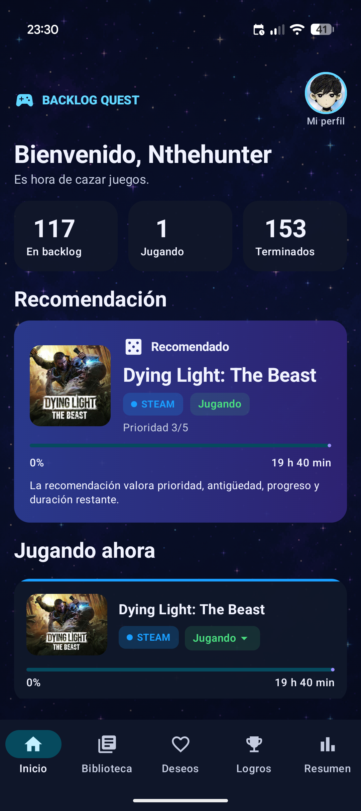
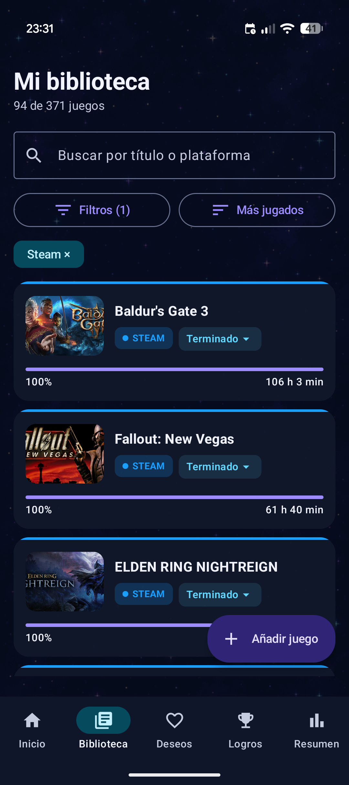
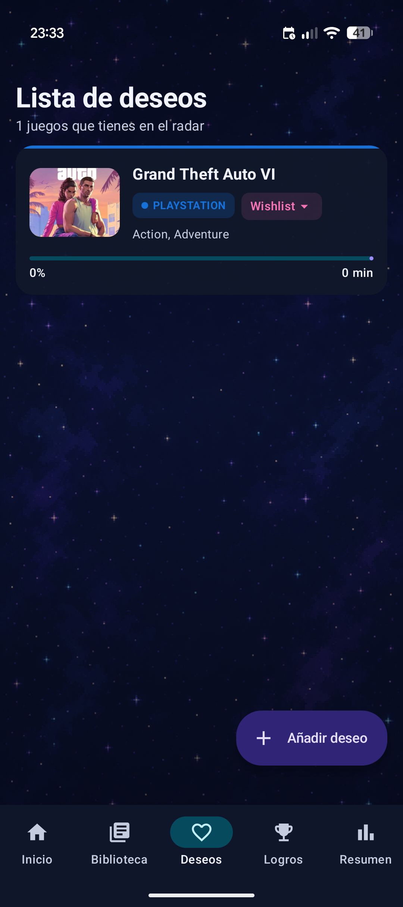
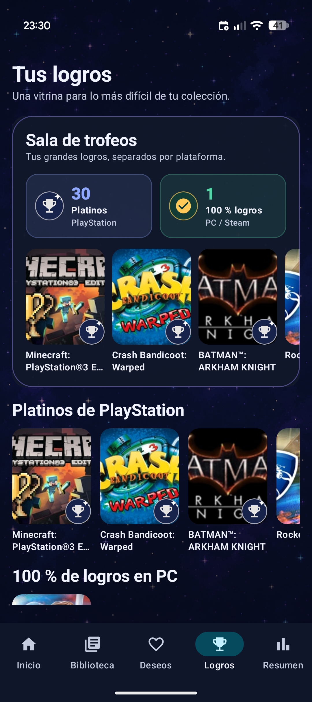
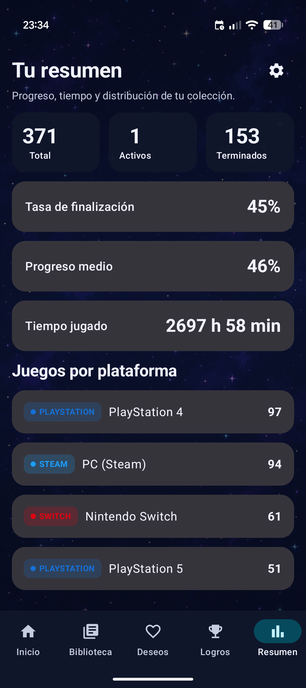

# Backlog Ga Kill (BGK)

Aplicación Android para reunir tu biblioteca de videojuegos, decidir qué jugar y
llevar el progreso sin depender de una cuenta propia ni de un servidor de BGK.
Los datos principales se guardan de forma local en el dispositivo.

El diseño recupera la identidad visual de
[HuntTheGame](https://github.com/Nthehunter/HuntTheGame), mi proyecto anterior:
fondos estrellados, tarjetas oscuras y una interfaz centrada en la colección.

## Capturas

<p align="center">
  
  
  
  
  
</p>

<p align="center">
  <sub>Inicio · Biblioteca · Deseos · Logros · Resumen</sub>
</p>

## Funciones

- Biblioteca, lista de deseos y perfil local.
- Estados `Pendiente`, `Jugando`, `Pausado`, `Terminado`, `Abandonado`,
  `Rejugando` y `Sin final`.
- Búsqueda, filtros compactos y distintas formas de ordenar la colección.
- Registro de horas, sesiones, progreso, prioridad y notas.
- Recomendación del siguiente juego y resumen de estadísticas.
- Importación desde Steam, PlayStation Network y Nintendo Switch.
- Vitrina separada para platinos de PlayStation y 100 % de logros de PC.
- Exportación e importación de copias JSON para cambiar de móvil.
- Catálogo RAWG con TheGamesDB como proveedor alternativo.
- Persistencia offline con Room e interfaz creada con Jetpack Compose.

## Requisitos

- Android Studio con JDK 17.
- Android SDK 35.
- Android 7.0 (API 24) o posterior para ejecutar la app.

El proyecto incluye Gradle Wrapper, por lo que no hace falta instalar Gradle por
separado.

## Puesta en marcha

1. Clona el repositorio y ábrelo desde Android Studio.
2. Copia `local.properties.example` como `local.properties`.
3. Deja que Android Studio añada `sdk.dir`, si todavía no existe.
4. Completa solamente las integraciones que quieras utilizar.
5. Sincroniza Gradle y ejecuta la app en un emulador o móvil.

En Windows también se puede compilar desde una terminal:

```powershell
.\gradlew.bat assembleDebug
```

En macOS o Linux:

```bash
./gradlew assembleDebug
```

El APK de depuración se genera en
`app/build/outputs/apk/debug/app-debug.apk`.

Todas las integraciones son opcionales. La biblioteca manual, el perfil, las
sesiones y las copias de seguridad funcionan sin claves externas.

## Configuración privada

Las credenciales se leen desde `local.properties`, archivo excluido de Git. La
plantilla segura tiene este formato:

```properties
rawg.api.key=
thegamesdb.api.key=
steam.api.key=
steam.id=
psn.npsso=
```

No pongas valores reales en `local.properties.example` ni directamente en el
código fuente.

> [!IMPORTANT]
> Android incorpora los valores de `local.properties` al APK durante la
> compilación. No publiques un APK generado con tus claves personales. Para
> distribuir un APK público, compílalo con las propiedades vacías o con
> credenciales específicas y restringidas para distribución.

## Catálogo de juegos

La app consulta primero RAWG y utiliza TheGamesDB si el proveedor principal no
está disponible. Puedes configurar uno o ambos:

1. Solicita una clave en [RAWG API](https://rawg.io/apidocs).
2. Para el proveedor alternativo, consulta
   [TheGamesDB API](https://api.thegamesdb.net/).
3. Añade las claves a `local.properties`:

```properties
rawg.api.key=TU_CLAVE_RAWG
thegamesdb.api.key=TU_CLAVE_THEGAMESDB
```

Al seleccionar un resultado se completan el título, plataforma, género e
imagen. Si no hay ninguna API configurada, el juego se puede crear manualmente.

## Importar desde Steam

La importación obtiene los juegos de la cuenta, las horas jugadas y, cuando el
juego expone esa información, el 100 % de logros.

1. Obtén una clave en
   [Steam Web API](https://steamcommunity.com/dev/apikey).
2. Localiza tu `SteamID64`, el identificador numérico de tu perfil.
3. En la privacidad de Steam, establece **Detalles de juegos** como público.
4. Configura:

```properties
steam.api.key=TU_CLAVE_WEB_API
steam.id=TU_STEAMID64
```

5. En la app, abre **Resumen → Ajustes → Steam** y pulsa
   **Actualizar desde Steam**.

Las actualizaciones conservan los cambios locales y no vuelven a crear juegos
que ya estén en la biblioteca.

## Importar desde PlayStation Network

PlayStation no proporciona una API pública para este caso. BGK utiliza la sesión
NPSSO y los servicios que usa PlayStation para leer los títulos con trofeos,
su progreso y los platinos.

1. Inicia sesión en [PlayStation](https://www.playstation.com/) desde el navegador.
2. En el mismo navegador abre
   [el endpoint de la cookie SSO de Sony](https://ca.account.sony.com/api/v1/ssocookie).
3. Copia solamente el valor de `npsso` en:

```properties
psn.npsso=TU_NPSSO
```

4. En la app, abre **Resumen → Ajustes → PlayStation Network**.

El NPSSO equivale a una credencial de acceso: no lo compartas, no lo subas a
Git y genera uno nuevo si se filtra. La importación muestra juegos que tengan
trofeos sincronizados; no representa necesariamente todas las compras de la
cuenta. El flujo de autenticación está documentado también por
[psn-api](https://github.com/achievements-app/psn-api).

## Importar desde Nintendo Switch

Nintendo se conecta desde la propia app y no necesita ninguna propiedad en
`local.properties`:

1. Abre **Resumen → Ajustes → Nintendo Switch**.
2. Pulsa **Conectar Nintendo** e inicia sesión en el navegador.
3. Al volver a BGK, la importación se completa automáticamente.
4. Usa **Actualizar desde Nintendo** para refrescar las horas posteriormente.

La sesión duradera se cifra con Android Keystore y puede eliminarse con
**Desconectar cuenta**. Se importan los juegos del historial de actividad y sus
horas, no las compras que nunca se hayan iniciado. Los códigos internos `HAC` y
`BEE` se muestran como Nintendo Switch y Nintendo Switch 2.

Nintendo no publica esta API. La integración usa el servicio de historial de la
aplicación Nintendo Store y podría dejar de funcionar si Nintendo lo modifica.
El flujo OAuth/PKCE y el formato del historial se verificaron tomando como
referencia [robtme/nintendo-go](https://github.com/robtme/nintendo-go), publicado
bajo [Apache License 2.0](https://github.com/robtme/nintendo-go/blob/main/LICENSE).
La implementación de BGK está escrita en Kotlin.

## Pasar los datos a otro móvil

En **Resumen → Ajustes → Copias de seguridad**:

1. Pulsa **Exportar copia** en el móvil antiguo.
2. Envía el archivo JSON al nuevo móvil.
3. Instala BGK y pulsa **Importar copia**.

La importación sustituye la biblioteca local del dispositivo de destino. Guarda
una copia reciente antes de realizarla.

## Publicar un fork sin filtrar secretos

Antes de cada `push`, comprueba que `local.properties` aparece como ignorado:

```bash
git check-ignore local.properties
git status --short --ignored
```

Un primer envío a GitHub puede hacerse con:

```bash
git init
git add .
git status
git commit -m "Initial public version"
git branch -M main
git remote add origin https://github.com/TU_USUARIO/TU_REPOSITORIO.git
git push -u origin main
```

Revisa `git status` antes del commit. No deben aparecer `local.properties`,
archivos `.jks`/`.keystore`, APK personales, `.env` ni copias privadas.

Si alguna clave llegó a incluirse en un commit, eliminar el archivo en otro
commit no es suficiente: revoca o regenera la credencial y limpia el historial
antes de publicar.

## Tecnología

- Kotlin 2.0.21 y JDK 17.
- Android Gradle Plugin 8.13.2 y Gradle 8.13.
- Jetpack Compose con Material 3.
- Room 2.6.1 y KSP.
- Coil 2.7.0 para imágenes.
- Compile/Target SDK 35 y Minimum SDK 24.

## Referencias y agradecimientos

- [Nthehunter/HuntTheGame](https://github.com/Nthehunter/HuntTheGame): origen e
  inspiración del lenguaje visual de BGK.
- [robtme/nintendo-go](https://github.com/robtme/nintendo-go): referencia del
  inicio de sesión y del historial de Nintendo Store (Apache-2.0).
- [achievements-app/psn-api](https://github.com/achievements-app/psn-api):
  documentación comunitaria del inicio de sesión NPSSO y trofeos de PSN (MIT).
- [RAWG](https://rawg.io/apidocs), [TheGamesDB](https://thegamesdb.net/) y
  [Steam Web API](https://steamcommunity.com/dev): proveedores externos de
  metadatos o bibliotecas.
- Android, Kotlin, Jetpack Compose, Room y Coil pertenecen a sus respectivos
  autores y se utilizan mediante las dependencias declaradas por Gradle.

BGK no está afiliada, patrocinada ni aprobada por Nintendo, Sony, PlayStation,
Valve, Steam, RAWG o TheGamesDB. Las marcas pertenecen a sus propietarios.
